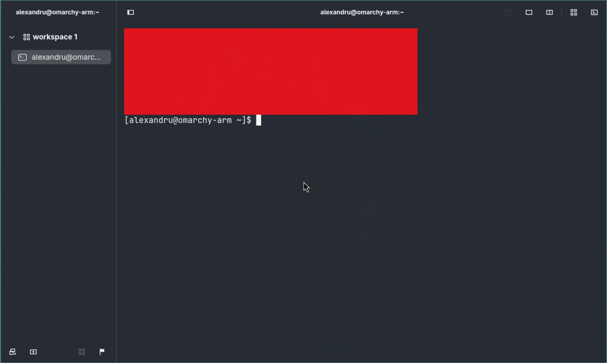
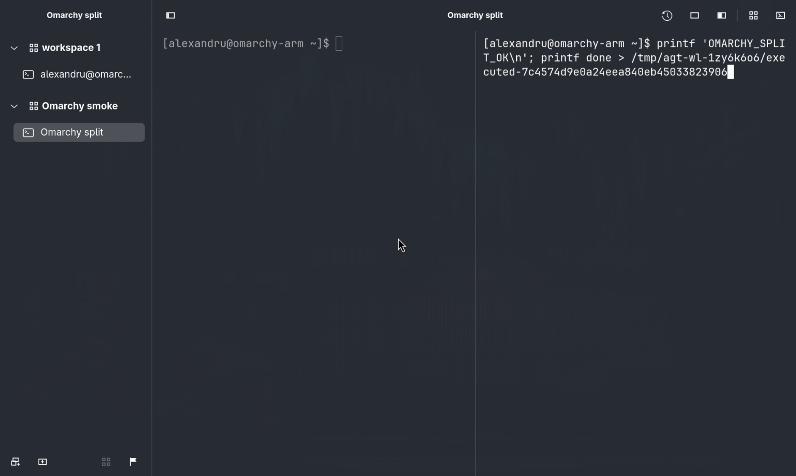
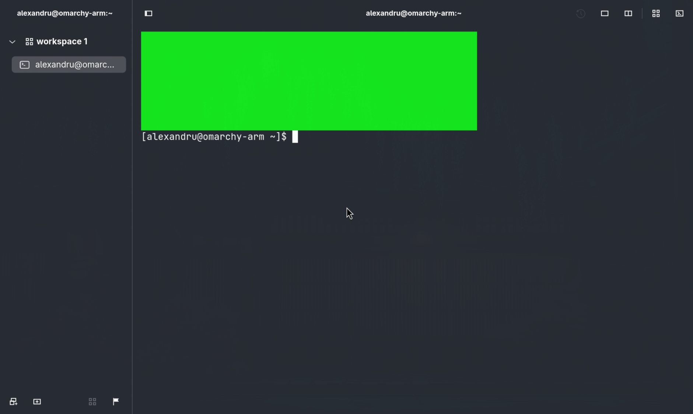
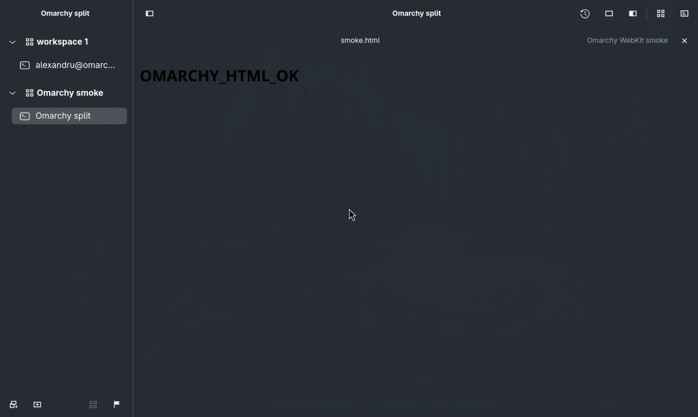

# Native Omarchy ARM64 evidence — 2026-10-29

This bundle preserves selected native VM evidence for [task #22](https://github.com/alexandru-savinov/agterm-omarchy/issues/22).
It covers an isolated ARM64 Omarchy/Hyprland desktop, including a relocated release payload.
The root operator executed the runtime tests; the test_plan agent independently inspected retained files and compared current VM source/binary hashes.
Both use the authorized shared GitHub account; this is not an independent-account approval.
It is not a GitHub-hosted build attestation or a claim that every graphics driver is supported.

## Results and scope

| Evidence | Observed result | Provenance |
|---|---|---|
| [Debug result](results/debug.json) | Seven checks passed | Operator's debug run; result file inspected independently |
| [Relocated release result](results/relocated-release.json) | Seven checks passed | Relocated payload; result file and selected screenshots inspected independently |
| [Final Live result](results/live-final.json) and [cleanup](results/live-final-cleanup.json) | Nine checks passed; cleanup passed with three tracked test daemons | Final run `wayland-live-final.v7lL10`; files independently fetched from the VM |
| [Intentional failed-restart result](results/failed-restart.json) and [cleanup](results/failed-restart-cleanup.json) | Expected `passed=false` after two initial checks; cleanup passed with one tracked daemon | Fixture run `wayland-failed-restart.KGFCvN`; files independently fetched from the VM |
| Native shared core tests | 4,025 tests in 175 suites passed | [Operator report](https://github.com/alexandru-savinov/agterm-omarchy/issues/5#issuecomment-6506869967); not rerun for this documentation change |
| Native Linux frontend tests | 553 tests in 81 suites passed | [Operator report](https://github.com/alexandru-savinov/agterm-omarchy/issues/15#issuecomment-6507348032) |
| Installer fixtures and relocation | Eight fixtures passed; ELF/resource checks passed with original source/prefix/toolchain absent | [Packaging report](https://github.com/alexandru-savinov/agterm-omarchy/issues/15#issuecomment-6507277255) and [test report](https://github.com/alexandru-savinov/agterm-omarchy/issues/15#issuecomment-6507348032) |

The seven ordinary smoke gates cover shell execution and screen read-back, red-to-green terminal pixels, workspace/session/split execution, program overlay/dismissal/restored input, WebKitGTK HTML load, teardown, and absence of specified GL-context/app CSS failures.
The harness uses execution marker files so a merely echoed command does not satisfy shell-input acceptance.
Native Wayland was checked from compositor client metadata; these runs were not XWayland acceptance.

The tested desktop used Hyprland 0.56.1, GTK 4.22.4, and GLib 2.88.3.
`LIBGL_ALWAYS_SOFTWARE=1` was scoped to the launched process after the UTM guest's inherited hardware-rendering setting failed to provide an EGL configuration.
No persistent compositor/user configuration was changed.
The release run invoked the installed wrappers after unsetting `LD_LIBRARY_PATH`, as recorded in the [operator handoff](https://github.com/alexandru-savinov/agterm-omarchy/issues/15#issuecomment-6507327094).

## Live restart and failure cleanup

The [final Live handoff](https://github.com/alexandru-savinov/agterm-omarchy/issues/22#issuecomment-6507668460)
reports the cleanup-reviewed harness run, superseding the earlier Live run for teardown acceptance.
The retained result records a zmx-backed shell and matching shell PID across application shutdown/relaunch.
The [harness](https://github.com/alexandru-savinov/agterm-omarchy/blob/7a8d4b71/scripts/test-omarchy.sh)
compares PID marker files before recording that check; those temporary files are removed during successful cleanup.
Their numeric values are not independently recoverable from this retained result alone.

Live mode requires a supported login shell.
The VM account's real login shell was bash, so the operator used the repository's `login_shell_zsh_fixture.c`
to supply a process-local password-database fixture selecting zsh.
No account/login-shell configuration was changed.
The unsupported-bash attempt is not counted as a Live success; see the [operator report](https://github.com/alexandru-savinov/agterm-omarchy/issues/5#issuecomment-6507505647).

The intentional failed-restart result is deliberately unsuccessful.
Its separate successful cleanup record demonstrates that the captured test daemon was removed even when frontend restart failed.
The cleanup count measures tracked test-owned daemon names, not every process on the machine.
The successful final run tracked three names; the failure fixture tracked one.

## Unmodified isolated screenshots

The screenshots below were visually inspected before inclusion.
They show the isolated test shell/window, synthetic marker commands, temporary fixture paths, and the test account's prompt.
No screenshot has been cropped, redacted, regenerated, or otherwise edited.
The original PNGs contain only image chunks, without embedded textual metadata.

| Terminal color change | Split and HTML overlay |
|---|---|
|  |  |
|  |  |

Screenshots supplement the machine-readable result; a still image alone does not establish process continuity or successful cleanup.

## Build identity boundaries

The original relocated payload reports `c7b53503-dirty` and version `0.35.1-omarchy.dev`.
Its source already included the GLib fix later committed as `5e37cb75ce3d4879ca8b7c74ed28d0548780163a`.
The rebuilt development archive's metadata reports `5e37cb75`; those labels are preserved rather than rewritten to a later integration commit.
The local archive is `agterm-omarchy-0.35.1-dev-aarch64.tar.gz`, SHA256 `44cd72f71993a46fd991101e065b361c87c40cb01835b2c259def52057ae7cb7`.
This bundle contains evidence, not that 61 MiB archive.

[provenance.json](provenance.json) records the direct comparison:
all four ELF components (app, CLI, zmx, libghostty) are byte-identical across the native build/vendor outputs,
the relocated payload, and the development archive.
All four identify AArch64 (`e_machine=183`).
The 371 tracked files in the current VM checkout all match their exact committed bytes; no mismatches were found.
These comparisons establish the stated equivalence without changing either artifact's metadata.

[compilation-inputs.sha256](compilation-inputs.sha256) enumerates the 371 tracked files under both packages' `Sources` trees plus tracked package manifests/lockfiles at `5e37cb75`.
It includes package resources and some platform-conditional sources; it is not a list limited to the files compiled by one Swift target.
External toolchain/system libraries and dependency checkout contents are outside that tracked-source manifest.
A post-build source comparison establishes correspondence at inspection time, not a cryptographically attested history of compiler inputs.

[Hosted CI 40941708442](https://github.com/alexandru-savinov/agterm-omarchy/actions/runs/40941708442) tested older source head `aac39b6481e0aa974e92b13c3cd8757b34a1e428` as synthetic merge `781b194cad54b4db5c05d576ee9074e2aa7f46e4`.
Its native ARM64/x86_64 matrix is separate from these VM runs and predates the later GLib/Hyprland harness fixes.
Final-source hosted checks and any release promotion require their own exact run/artifact identity.

## Verification and privacy

From this directory, verify the bundle's retained bytes with:

```sh
sha256sum -c SHA256SUMS
```

The bundle excludes raw application state, environment dumps, credentials, full control transcripts, and unrelated terminal output.
Original result/cleanup JSON and selected PNG bytes are retained unmodified; explanatory provenance records are explicitly derived checks.
Use the repository's [Omarchy guide](https://github.com/alexandru-savinov/agterm-omarchy/blob/omarchy/packaging/linux/omarchy.md) for current installation/test commands and [agent protocol](../../AGENT_PROTOCOL.md) for coordination.
