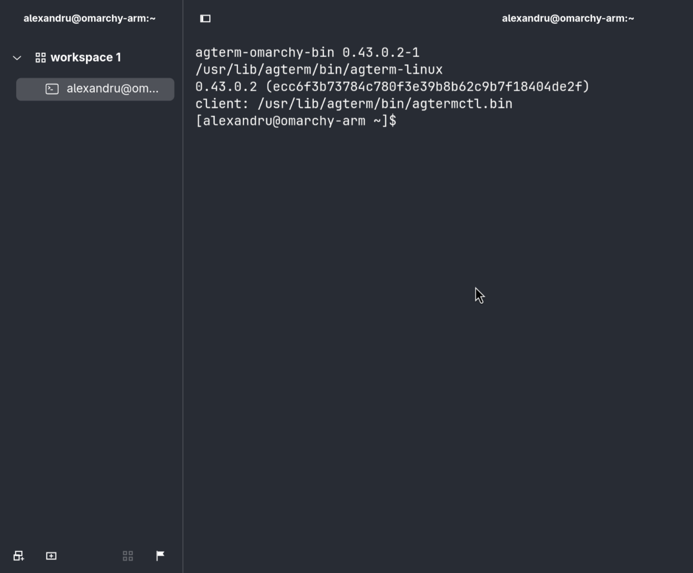

# Draft pull request for omacom/omarchy-pkgs

Open it as a draft: a non-draft PR that only touches packages merges itself once green.
`#3184` is the package request, already posted. Nothing in this file has been posted.

**Title:** `Add agterm-omarchy-bin`

---

I maintain `agterm-omarchy-bin`, requested in #3184: a prebuilt x86_64 and aarch64 package of the agterm terminal (libghostty, a workspace and session sidebar, Live sessions, the `agtermctl` control CLI). Each release is cut and published automatically, only after native Omarchy gates under Hyprland pass on both architectures, and carries a build-provenance attestation. If a release breaks, OPR doesn't take it for 24 hours (`min_release_age`), while the same gates rerun on the published release; a failure demotes it to a prerelease, which the upstream watch skips.

The app is umputun's [agterm](https://github.com/umputun/agterm) (MIT), and the GTK4/libadwaita Linux port is melonamin's [agterm-linux](https://github.com/melonamin/agterm-linux), whose releases ship x86_64 packages (Arch, .deb, .rpm). This package builds from releases of my fork, [agterm-omarchy](https://github.com/alexandru-savinov/agterm-omarchy). The fork adds aarch64 builds, the gated and attested releases described above, and two fixes: a launcher-scoped retry for GTK's EGL config request on Mesa 26.3.1 (Omarchy edge, [GNOME/gtk#8566](https://gitlab.gnome.org/GNOME/gtk/-/work_items/8566)), and HTML-overlay paste that holds a paste until the clipboard's formats are known and refuses mixed file and text offers.

**Package**

- Installs the [`omarchy-v<PIN>`](https://github.com/alexandru-savinov/agterm-omarchy/releases/tag/omarchy-v<PIN>) archives, with the sha256 values from its `SHA256SUMS`, to `/usr/lib/agterm`. It adds `/usr/bin/agterm-linux` and `/usr/bin/agtermctl` symlinks, the desktop entry, the icons and the license.
- Extracts the archive with `bsdtar --no-same-owner`. The Swift runtime, libghostty and a private zmx ship as CI built and tested them (`!strip !debug`), and the bundled terminfo and Ghostty resources stay under `/usr/lib/agterm`.
- `depends` are the owners of the binaries' `NEEDED` libraries outside the archive's own `lib/`.
- `provides=(agterm-linux)` and `conflicts=(agterm-linux agterm-linux-bin)`, because `agterm-linux-bin` (melonamin's release package, and the AUR package of the same name) installs the same commands. Neither name is in OPR, so there is no `approved` line.
- Upstream watch on `omarchy-v` GitHub Releases, with `min_release_age` set to `24h`.
- The `release/owners.json` line was written by `bin/release-owners agterm-omarchy-bin`.
- `agterm-omarchy-bin.install` prints how to turn on the Omarchy integration after install, and the absolute CLI path to use if an older `~/.local` agterm shadows it.

**On Omarchy**

<!-- Reviewer evidence. Strip every HTML comment from pr-body.md before posting.
     VM = ops native-feel/results/omarchy-v0.43.0.8-20261122-035434.tsv (aarch64 Omarchy VM, Hyprland 0.57.2,
     LIBGL_ALWAYS_SOFTWARE=1, package 0.43.0.8-1 via pacman -U, `integration omarchy enable` on).
     Lines marked RE-RUN AT <PIN> were FAIL on 0.43.0.8 because the fix shipped later; keep them only if the
     native-feel run at <PIN> passes the named rows, otherwise move them to Known limitations. -->

- `agtermctl integration omarchy enable` makes agterm the default terminal, adds Super+C/V copy and paste and Omarchy's terminal opacity, and `disable` restores `hyprland.lua` byte for byte.
  <!-- Super+C/V, opacity, disable: VM rows "KEYS Super+C copies without interrupting" PASS, "KEYS Super+V pastes" PASS,
       "LOOK Opacity active/inactive" PASS (0.985/0.96), "REMOVAL integration omarchy disable restores hyprland.lua" PASS.
       "makes agterm the default terminal": issue #537, NOT in main yet; VM row "SETUP default-terminal" set
       xdg-terminals.list by hand. RE-RUN AT <PIN> after #537 ships, or drop the clause. -->
- Super+Return and Omarchy's launchers open agterm: a new window in the running agterm in the folder Omarchy passes, and `omarchy-launch-tui`, the floating launcher and the menu's installers as separate terminals with Omarchy's app ID.
  <!-- VM "LAUNCHING Super+Return cold" PASS (3/3). Warm Super+Return, launch-tui, floating launcher, menu installer:
       VM FAIL on 0.43.0.8; fixed by #531 (afc91d5f, released omarchy-v0.43.0.10), covered by
       agterm-linux/tests/atspi_terminal_launcher.py and LinuxDesktopActionsTests.swift, documented in
       packaging/linux/omarchy.md "Omarchy terminal launches". RE-RUN AT <PIN>. -->
- With **Follow Omarchy**, on by default, agterm follows `omarchy theme set` live, and `omarchy font set`, `omarchy display text size`, Omarchy's terminal padding and its non-blinking cursor.
  <!-- Theme: VM "LOOK omarchy theme set follows live" PASS (111C18 -> 1A1B26), and btop survived it.
       Font, text size, padding, cursor blink: VM FAIL on 0.43.0.8; fixed by #534 (44e9828c, 23e13e82, released
       omarchy-v0.43.0.9), covered by OmarchyAppearanceConfigTests.swift and GLibMainTimerTests.swift, documented in
       packaging/linux/omarchy.md lines 106-112. RE-RUN AT <PIN>. "on by default": OmarchyTheme.swift:115, `follows` falls back to `theme.isInstalled`. -->
- Shift+Enter and Alt+Shift+Enter send the same CSI-u bytes as Omarchy's Ghostty (`ESC[13;2u`, `ESC[13;4u`), so agents that bind them behave as they do in Ghostty; Shift+Insert pastes and Ctrl+Insert copies.
  <!-- Ghostty bytes: VM rows "KEYS Shift+Enter sends CSI-u" / "Alt+Shift+Enter" (Omarchy's Ghostty column).
       agterm: VM FAIL on 0.43.0.8 (`ESC[27;2;13~`); fixed by #538 (4b5091d6, on main after omarchy-v0.43.0.10,
       NOT yet in a release), covered by agterm-linux/tests/atspi_omarchy_keys.py, documented in omarchy.md line 117.
       Ctrl+Insert: VM PASS. Shift+Insert: VM FAIL on 0.43.0.8, same fix. RE-RUN AT <PIN>. -->
- Works with the community bar plugin [agterm for Omarchy](https://github.com/dmitriiweb/omarchy-agterm) by dmitriiweb: it shows agterm's sessions, and an agent's status hook updates its count.
  <!-- VM "AROUND Bar plugin reads agterm" PASS and "AGENTS Bar plugin count follows the hook" PASS, plugin
       dmitriiweb.agterm pinned at dff31701; also native-feel-checklist.md Table 3 (v0.1.4 e2e 1/1). Name: manifest.json "agterm for Omarchy"; URL: ops vm-results.md line 46. -->
- agterm's quick terminal (Ctrl+\`) doesn't collide with Omarchy's console (Super+\`).
  <!-- VM "AROUND Super+` goes to Omarchy's console, not agterm" PASS and "agterm quick terminal (Ctrl+`) in agterm" PASS. -->

**Known limitations**

- Omarchy's **Setup ▸ Defaults ▸ Terminal** menu has no agterm entry, so it shows no checkmark while agterm is the default.
  <!-- VM "AROUND Default-terminal menu checkmark" LIMITATION (menu entries naming agterm: 0); checklist Table 1 AROUND row. -->
- In a window with several sessions, `omarchy-cmd-terminal-cwd` returns the folder of the newest shell, not the focused one.
  <!-- VM "LAUNCHING Terminal cwd with two live shells" LIMITATION (focused /usr/share, returned /etc); checklist Table 1. -->
- Native feel was measured on aarch64 (an Omarchy VM) with software rendering only. Hardware GL rendering and touchpad scroll feel are untested, and no Hyprland rule sets agterm's touchpad scroll factor yet.
  <!-- VM "SETUP install" (LIBGL_ALWAYS_SOFTWARE=1), "LOOK Touchpad scroll feel" MANUAL (no touchpad),
       "LOOK Touchpad scroll factor rule" FAIL (0.8 vs Ghostty's 0.2). -->
- x86_64 is covered by the container install test below, not by the native-feel checks.
  <!-- run 44896694600, job "pacman -U and Hyprland x86_64 (Arch container, vkms)". -->

**Tested** ([evidence](https://github.com/alexandru-savinov/agterm-omarchy/pull/468#issuecomment-7061665070))

- `bin/build` at `5c7d21d2` on `ubuntu-24.04` and `ubuntu-24.04-arm` ([run](https://github.com/alexandru-savinov/agterm-omarchy/actions/runs/44896694600)):
  - every file is owned by root;
  - namcap reports no errors on the package or the PKGBUILD;
  - `ldd -r` resolves everything, the highest glibc symbol is `GLIBC_2.38`, and `desktop-file-validate` passes.
- `tests/pinned-sources.sh`, `tests/pkgname-unique.sh`, `bin/check-shadowed` and `bin/release-owners --check` pass, and `helpers/upstream-watch.py check` reports "already current".
- x86_64, in the native gates' Arch container with Omarchy's stable packages and Hyprland 0.56.2 on vkms (Mesa 26.2.5), from the package `bin/build` made in the same [run](https://github.com/alexandru-savinov/agterm-omarchy/actions/runs/44896694600):
  - `pacman -U` installed it without pulling in any new package, on top of Omarchy's base packages and the gates' GTK/WebKitGTK runtime;
  - through `/usr/bin`, the app passed 7/7 ordinary and 9/9 Live-session checks under Hyprland with software rendering;
  - `pacman -R` removed all 542 files.
- On an aarch64 Omarchy VM (Arch Linux ARM, Hyprland 0.57.2, Mesa 26.2.7):
  - `pacman -U` installed it without pulling in any new package;
  - through `/usr/bin`, the app passed 7/7 ordinary and 9/9 Live-session checks under Hyprland with software rendering;
  - `pacman -R` removed all 542 files.
- The release's own native gates passed on x86_64 and aarch64 against the stable channel (Mesa 26.2.5) ([run](https://github.com/alexandru-savinov/agterm-omarchy/actions/runs/44882977083)). The EGL retry passed the same gates on edge (Mesa 26.3.1) at an earlier commit with the same retry code ([run](https://github.com/alexandru-savinov/agterm-omarchy/actions/runs/44647147715)).
<!-- The runs above are for 0.43.0.2. Replace them with the <PIN> runs before posting. -->



It's a draft so you can look before it merges itself; I'll mark it ready when you're happy with it.

Prepared and posted with AI assistance (Claude Code) on my behalf.

---

## Files and branch plan (for mac_lead, not posted)

The PR changes exactly four files on top of omarchy-pkgs `master`:

| File | Change | Source here |
|---|---|---|
| `pkgbuilds/agterm-omarchy-bin/PKGBUILD` | added | `packaging/omarchy-pkgs/agterm-omarchy-bin/PKGBUILD` |
| `pkgbuilds/agterm-omarchy-bin/agterm-omarchy-bin.install` | added | `packaging/omarchy-pkgs/agterm-omarchy-bin/agterm-omarchy-bin.install` |
| `pkgbuilds/agterm-omarchy-bin/.omarchy/package.json` | added | `packaging/omarchy-pkgs/agterm-omarchy-bin/.omarchy/package.json` |
| `release/owners.json` | one line added, between `aether` and `alsa-ucm-conf` | `packaging/omarchy-pkgs/owners.json.line` |

- **Fork and branch:**
  - the fork `alexandru-savinov/omarchy-pkgs` exists, and branch `add-agterm-omarchy-bin` is pushed there: one commit, `2b7c0d23`, on upstream `master` `2723852d`;
  - the commands below are how it was made; rebase it if `master` moves before posting.
- **Base commits:** CI's checks ran at `5c7d21d2af2fa1bea38b5c0dffeda4dfe40a6ab6`. The branch is on `2723852d8b526e71c7cfc3c540d912138a1adb22` (2026-11-21), and nothing in `bin/`, `helpers/`, `tests/`, `build/`, `.github/` or the existing `release/owners.json` lines changed between them. At `2723852d`, on Arch, `bin/release-owners` reproduces the committed line, and `release-owners --check`, `package-metadata`, `package-owners`, `pgp-keys-vendored`, `pinned-sources` and `pkgname-unique` pass; `upstream-watch` reports "already current".
- **`release/owners.json`:** omarchy-pkgs' `AGENTS.md` says never to edit the directory lines by hand. Run `bin/release-owners agterm-omarchy-bin` on Arch, as a non-root user, and check that it adds exactly `owners.json.line`. This repository's `omarchy-pkgs recipe build` workflow does this on every run.

```bash
gh repo fork omacom/omarchy-pkgs --clone=false
git clone https://github.com/alexandru-savinov/omarchy-pkgs.git && cd omarchy-pkgs
git remote add upstream https://github.com/omacom/omarchy-pkgs.git && git fetch upstream
git switch -c add-agterm-omarchy-bin upstream/master
AGTERM=~/src/agterm-omarchy   # any checkout that has fetched claude/omarchy-pkg-465
mkdir -p pkgbuilds/agterm-omarchy-bin/.omarchy
for f in PKGBUILD agterm-omarchy-bin.install .omarchy/package.json; do
  git -C "$AGTERM" show <RECIPE-COMMIT>:packaging/omarchy-pkgs/agterm-omarchy-bin/$f > pkgbuilds/agterm-omarchy-bin/$f
done
bin/release-owners agterm-omarchy-bin   # on Arch, non-root
git diff release/owners.json            # exactly the line in owners.json.line
tests/pinned-sources.sh && tests/pkgname-unique.sh
python helpers/upstream-watch.py check pkgbuilds/agterm-omarchy-bin   # "already current"
git add pkgbuilds/agterm-omarchy-bin release/owners.json && git commit -m "Add agterm-omarchy-bin"
git push -u origin add-agterm-omarchy-bin
gh pr create --draft -R omacom/omarchy-pkgs --base master \
  --head alexandru-savinov:add-agterm-omarchy-bin --title "Add agterm-omarchy-bin" --body-file pr-body.md
```

- **Recipe bytes:** `<RECIPE-COMMIT>` is the #468 commit that bumps `pkgver` to `<PIN>` and that CI and the VM test; the commands copy the three recipe files from it. The 0.43.0.2 bytes were `56ee67ae`, tested by CI runs 44893403760 and 44896694600 and the VM.
- **PR body:** `pr-body.md` is everything between the two `---` rules above, with every `<!-- -->` comment removed and no `<PIN>` left.
- **On the day:** bump `pkgver` to `<PIN>` with that release's `SHA256SUMS`, run this repo's recipe build and the native-feel run on it, then settle each `RE-RUN AT <PIN>` comment.
- **Interim pin:** the recipe is at 0.43.0.10 (`28925988`) so `upstream-watch` keeps reporting "already current" until `<PIN>`; the screenshot and the Tested runs are still 0.43.0.2's.
- **Build approval:** `alexandru-savinov` isn't in `.github/VOUCHED.td` or a collaborator, so the PR shows **Awaiting build approval** until a maintainer labels it `build-approved`.
- **Auto-merge:** marking the PR ready for review, once it's trusted and green, arms auto-merge and publishes to `edge`.
